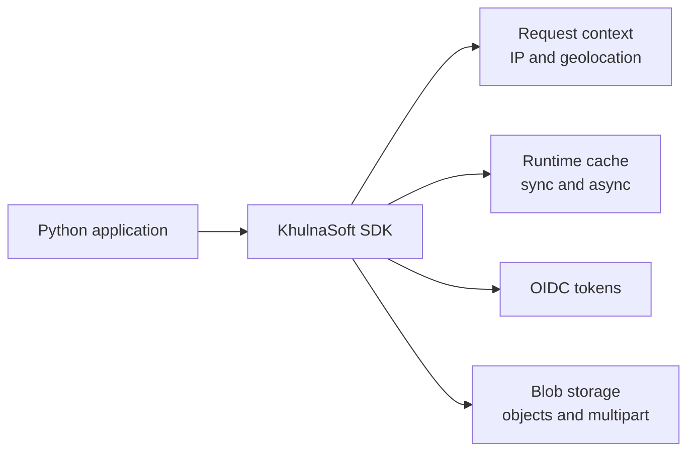

# KhulnaSoft Python SDK

Python clients for KhulnaSoft services, with synchronous and asynchronous APIs.



| Capability | Package | Typical use |
| --- | --- | --- |
| Request context | `khulnasoft.headers` | Read IP and geolocation headers |
| Runtime cache | `khulnasoft.cache` | Cache values with TTLs and tag invalidation |
| OIDC tokens | `khulnasoft.oidc` | Read identity and project claims |
| Blob storage | `khulnasoft.blob` | Upload, list, download, and manage objects |
| AI agents & models | `khulnasoft.ai` | Agents, models, tools, streaming, and telemetry |

## Contents

- [Installation](#installation)
- [Requirements](#requirements)
- [Request context](#request-context)
- [Runtime cache](#runtime-cache)
- [OIDC tokens](#oidc-tokens)
- [Blob storage](#blob-storage)
- [AI agents & models](#ai-agents--models)
- [Development](#development)

## Installation

```bash
pip install khulnasoft
```

## Requirements

- Python 3.12 or later

## Request context

```python
from typing import Callable

from fastapi import FastAPI, Request
from khulnasoft.headers import geolocation, ip_address, set_headers

app = FastAPI()


@app.middleware("http")
async def khulnasoft_context_middleware(request: Request, call_next: Callable):
    set_headers(request.headers)
    return await call_next(request)


@app.get("/api/headers")
async def headers_info(request: Request):
    ip = ip_address(request.headers)
    geo = geolocation(request)
    return {"ip": ip, "geo": geo}
```

## Runtime cache

### Synchronous helper
```python
from khulnasoft.cache import get_cache


def main():
    cache = get_cache(namespace="demo")

    cache.delete("greeting")
    cache.set("greeting", {"hello": "world"}, {"ttl": 60, "tags": ["demo"]})
    value = cache.get("greeting")  # dict or None
    cache.expire_tag("demo")  # invalidate by tag
```

### Synchronous client
```python
from khulnasoft.cache import RuntimeCache

cache = RuntimeCache(namespace="demo")


def main():
    cache.delete("greeting")
    cache.set("greeting", {"hello": "world"}, {"ttl": 60, "tags": ["demo"]})
    value = cache.get("greeting")  # dict or None
    cache.expire_tag("demo")  # invalidate by tag
```

### Asynchronous helper
```python
from khulnasoft.cache.aio import get_cache


async def main():
    cache = get_cache(namespace="demo")

    await cache.delete("greeting")
    await cache.set("greeting", {"hello": "world"}, {"ttl": 60, "tags": ["demo"]})
    value = await cache.get("greeting")  # dict or None
    await cache.expire_tag("demo")  # invalidate by tag
```

### Asynchronous client
```python
from khulnasoft.cache import AsyncRuntimeCache

cache = AsyncRuntimeCache(namespace="demo")


async def main():
    await cache.delete("greeting")
    await cache.set("greeting", {"hello": "world"}, {"ttl": 60, "tags": ["demo"]})
    value = await cache.get("greeting")  # dict or None
    await cache.expire_tag("demo")  # invalidate by tag
```

<br/>

---

<br/>

## OIDC tokens

```python
from typing import Callable

from fastapi import FastAPI, Request
from khulnasoft.headers import set_headers
from khulnasoft.oidc import decode_oidc_payload, get_khulnasoft_oidc_token

app = FastAPI()


@app.middleware("http")
async def khulnasoft_context_middleware(request: Request, call_next: Callable):
    set_headers(request.headers)
    return await call_next(request)


@app.get("/oidc")
def oidc():
    token = get_khulnasoft_oidc_token()
    payload = decode_oidc_payload(token)
    user_id = payload.get("user_id")
    project_id = payload.get("project_id")

    return {
        "user_id": user_id,
        "project_id": project_id,
    }
```

Notes:
- When run locally, this requires a valid KhulnaSoft CLI login on the machine running the code for refresh.
- Project info is resolved from `.khulnasoft/project.json`.

<br/>

---

<br/>


## Blob storage

Set `BLOB_READ_WRITE_TOKEN` in the environment or pass `token` when constructing a client.

### Synchronous usage


```python
from khulnasoft.blob import BlobClient

client = BlobClient()
# or BlobClient(token="...")

# Create a folder entry, upload a local file, list, then download
client.create_folder("examples/assets", overwrite=True)
uploaded = client.upload_file(
    "./README.md",
    "examples/assets/readme-copy.txt",
    access="public",
    content_type="text/plain",
)
listing = client.list_objects(prefix="examples/assets/")
client.download_file(uploaded.url, "/tmp/readme-copy.txt", overwrite=True)
```

### Asynchronous usage

```python
import asyncio
from khulnasoft.blob import AsyncBlobClient


async def main():
    client = AsyncBlobClient()  # uses BLOB_READ_WRITE_TOKEN from env

    # Upload bytes
    uploaded = await client.put(
        "examples/assets/hello.txt",
        b"hello from python",
        access="public",
        content_type="text/plain",
    )

    # Inspect metadata, list, download bytes, then delete
    meta = await client.head(uploaded.url)
    listing = await client.list_objects(prefix="examples/assets/")
    content = await client.get(uploaded.url)
    await client.delete([b.url for b in listing.blobs])


asyncio.run(main())
```

### Multipart uploads

For large files, the SDK provides three approaches with different trade-offs:

#### Automatic

The SDK handles everything automatically:

```python
from khulnasoft.blob import auto_multipart_upload

result = auto_multipart_upload(
    "large-file.bin",
    large_data,  # bytes, file object, or iterator
    part_size=8 * 1024 * 1024,  # 8MB parts (default)
)
```

Asynchronous:

```python
from khulnasoft.blob import auto_multipart_upload_async


async def main():
    result = await auto_multipart_upload_async("large-file.bin", large_data)
```

#### Uploader pattern

A middle-ground that provides a clean API while giving you control over parts and concurrency:

```python
from khulnasoft.blob import BlobClient, create_multipart_uploader

# Create the uploader (initializes the upload)
client = BlobClient()
uploader = client.create_multipart_uploader(
    "large-file.bin", content_type="application/octet-stream"
)

# Upload parts (you control when and how)
parts = []
for i, chunk in enumerate(chunks, start=1):
    part = uploader.upload_part(i, chunk)
    parts.append(part)

# Complete the upload
result = uploader.complete(parts)
```

Async version with concurrent uploads:

```python
from khulnasoft.blob import AsyncBlobClient, create_multipart_uploader_async

client = AsyncBlobClient()
uploader = await client.create_multipart_uploader("large-file.bin")

# Upload parts concurrently
tasks = [uploader.upload_part(i, chunk) for i, chunk in enumerate(chunks, start=1)]
parts = await asyncio.gather(*tasks)

# Complete
result = await uploader.complete(parts)
```

The uploader pattern is ideal when you:
- Want to control how parts are created (e.g., stream from disk, manage memory)
- Need custom concurrency control
- Want a cleaner API than the manual approach

Notes:
- Part numbers must be in the range 1..10,000.
- `add_random_suffix` defaults to True for the uploader (matches TS SDK); manual create defaults to False.
- Abort/cancel: an abortable uploader API is not yet exposed (future enhancement).

#### Manual

Full control over each step, but more verbose:

```python
from khulnasoft.blob import (
    create_multipart_upload,
    upload_part,
    complete_multipart_upload,
)

# Phase 1: Create
resp = create_multipart_upload("large-file.bin")
upload_id = resp["uploadId"]
key = resp["key"]

# Phase 2: Upload parts
part1 = upload_part(
    "large-file.bin",
    chunk1,
    upload_id=upload_id,
    key=key,
    part_number=1,
)
part2 = upload_part(
    "large-file.bin",
    chunk2,
    upload_id=upload_id,
    key=key,
    part_number=2,
)

# Phase 3: Complete
result = complete_multipart_upload(
    "large-file.bin",
    [part1, part2],
    upload_id=upload_id,
    key=key,
)
```

See [`examples/blob_storage_multipart.py`](examples/blob_storage_multipart.py) for complete working examples.

## AI agents & models

`khulnasoft.ai` provides agents, models, tools, streaming, and telemetry:

```python
import khulnasoft.ai as ai

agent = ai.Agent(tools=[...])

async with agent.run(model, messages) as stream:
    async for event in stream:
        ...
    print(stream.output)
```

Declare a tool with `@ai.tool`:

```python
@ai.tool
async def fetch(url: str) -> str:
    ...
```

Streaming tools use an `Aggregate` marker:

```python
@ai.tool
async def research(topic: str) -> ai.StreamingStatusTool[str]:
    yield "connecting..."
    yield body  # final yield is the tool result
```

See [`ai.REFACTORING_PLAN`](AI_REFACTORING_PLAN.md) for the module refactoring plan and design notes.

## Development

- Install dependencies and run the canonical checks:
```bash
uv sync --all-packages
uv run poe qa
```
- Build every workspace package:
```bash
uv build --all-packages --no-sources
```
- Pull requests run `poe lint`, `poe typecheck`, `poe coverage`, the
  news-fragment check, and a build of every package on Python 3.12. Pushes to
  `main` and the nightly schedule also run the tests on Python 3.10 through
  3.14.
- Release and publishing steps are documented in [`RELEASING.md`](RELEASING.md).
- Report security vulnerabilities as described in [`SECURITY.md`](SECURITY.md).
- We follow the [`CODE_OF_CONDUCT.md`](CODE_OF_CONDUCT.md); by participating you
  agree to its terms.

## License

MIT
